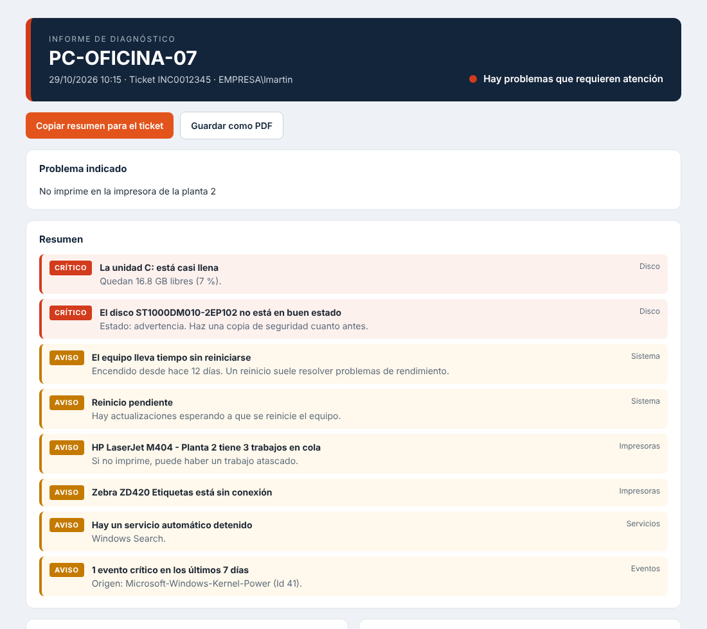
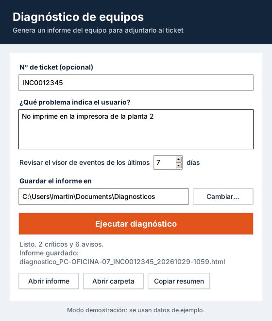

# Diagnóstico de equipos

Herramienta de escritorio para Windows que revisa el estado de un equipo en unos segundos y genera un informe HTML listo para adjuntar a un ticket de soporte. Marca lo que está mal (disco lleno, impresora sin conexión, fallo de DNS, reinicio pendiente…) para no tener que ir mirando pantalla por pantalla.



## Qué revisa

| Área | Datos |
| --- | --- |
| Equipo | Nombre, usuario, dominio, fabricante, modelo, número de serie, versión de Windows, último arranque |
| Rendimiento | Procesador, carga de CPU, memoria RAM, batería |
| Discos | Espacio de cada unidad y estado de salud de los discos físicos |
| Red | Adaptadores, IP, puerta de enlace, DNS, MAC, señal Wi-Fi y pruebas de conexión (puerta de enlace, internet, DNS y web) |
| Impresoras | Estado, puerto, controlador y trabajos en cola |
| Servicios | Servicios automáticos que están detenidos |
| Visor de eventos | Errores y eventos críticos de Sistema y Aplicación, agrupados por origen |
| Seguridad | Antivirus, última actualización instalada y reinicio pendiente |

Con esos datos genera una lista de avisos ordenada por gravedad. Por ejemplo: unidad con menos del 10 % libre, disco físico con fallos, IP 169.254.x.x (no llega el DHCP), DNS que no resuelve, impresora sin conexión o con trabajos atascados, antivirus desactivado, más de 7 días sin reiniciar o actualizaciones con más de 45 días.

El informe tiene un botón para **copiar un resumen en texto** y pegarlo en el ticket, y otro para **guardarlo como PDF**.

## Uso

Descarga `DiagnosticoEquipos.exe` de [Releases](../../releases) y ejecútalo. No necesita instalación ni permisos de administrador.



1. Escribe el número de ticket y lo que cuenta el usuario (opcional).
2. Pulsa **Ejecutar diagnóstico**.
3. El informe se abre en el navegador y se guarda en `Documentos\Diagnosticos`.

También se puede lanzar desde la línea de comandos con Python:

```bash
python main.py --cli --ticket INC0012345 --problema "No imprime" --salida C:\Diagnosticos
```

| Opción | Descripción |
| --- | --- |
| `--cli` | Ejecuta sin ventana y muestra el resumen por consola |
| `--ticket` | Número de ticket, se añade al informe y al nombre del archivo |
| `--problema` | Problema que indica el usuario |
| `--dias` | Días de eventos a revisar (7 por defecto) |
| `--salida` | Carpeta donde guardar el informe |
| `--json` | Guarda también los datos en bruto en JSON |
| `--demo` | Usa datos de ejemplo, sirve para probarlo fuera de Windows |

En modo `--cli` el código de salida es `0` si no hay avisos críticos, `2` si los hay y `1` si falla el diagnóstico, para poder usarlo en scripts.

## Cómo funciona

```
collect.ps1   PowerShell + CIM: recoge los datos del sistema y los devuelve en JSON
collector.py  lanza el script y hace las pruebas de red (ping, DNS, HTTP, Wi-Fi)
analysis.py   convierte los datos en avisos con su gravedad y genera el resumen
report.py     informe HTML autocontenido, sin dependencias externas
gui.py        ventana con tkinter; el diagnóstico corre en un hilo aparte
```

Solo usa la biblioteca estándar de Python. PyInstaller se usa únicamente para generar el `.exe`.

La herramienta solo lee información, no cambia nada en el equipo. Las únicas conexiones que hace son las pruebas de red: un ping a la puerta de enlace y a `1.1.1.1`, resolver `www.microsoft.com` y la comprobación de conectividad de Windows (`msftconnecttest.com`).

## Desarrollo

Requiere Python 3.10 o superior.

```bash
python -m unittest -v      # tests
python main.py --demo      # ventana con datos de ejemplo
build.bat                  # genera dist\DiagnosticoEquipos.exe
```

En cada push, GitHub Actions pasa los tests y ejecuta un diagnóstico real en un runner de Windows; el informe queda como artefacto del workflow. Al crear un tag `v*` se compila el `.exe` y se publica en Releases.

## Licencia

MIT
